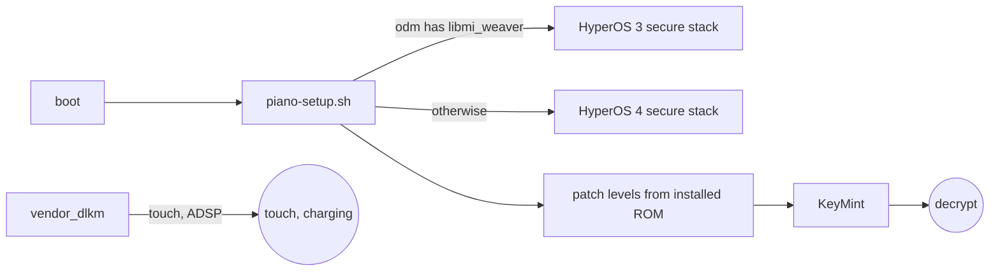

# Recovery for the Xiaomi Pad 8 Pro (piano)

One tree for **TWRP**, **YARP** (TWRP 16 with the new GUI2) and
**OrangeFox** R12.

Tested on HyperOS 4 with TWRP: touch, PIN decryption, firmware and
ROM zips, charging, backups and settings that survive a reboot. AOSP ROMs
built on either firmware use the same secure stack as the firmware itself.



## Build

GitHub Actions: **Build recovery** → TWRP, YARP, OrangeFox or all three.

Locally, in a `twrp-16.0` source (classic TWRP is `bootable/recovery`
`0315dbb5`, the last commit before GUI2; YARP uses the branch head) or a
`fox_16.0` OrangeFox source:

```
git clone https://github.com/xiaomi-pad-8-pro-development/android_device_xiaomi_piano-recovery -b seventeen device/xiaomi/piano
export PIANO_YARP=1   # YARP only
export PIANO_FOX=1    # OrangeFox only
device/xiaomi/piano/tools/apply-patches.sh
source build/envsetup.sh
export ALLOW_MISSING_DEPENDENCIES=true
lunch twrp_piano-bp2a-eng
m recoveryimage
```

`tools/apply-patches.sh` applies `patches/` to every recovery,
`patches-twrp/` to TWRP and YARP, `patches-yarp/` to YARP and
`patches-fox/` to OrangeFox. `tools/ci-sync.sh` is for the GitHub runner:
it leaves out most of the clang and rust prebuilts.

## Install

```
fastboot flash recovery_a recovery.img
fastboot flash recovery_b recovery.img
```

TWRP starts on US Central time; set yours once in Settings → Time zone.

Stock files come from the HyperOS 4 and HyperOS 3 China firmware via `tools/extract-files.py`.
