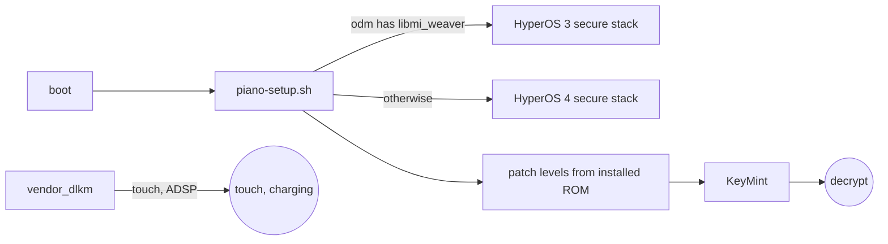

# Recovery for the Xiaomi Pad 8 Pro (piano)

One tree for **TWRP** and **OrangeFox**.

| Works with | |
| --- | --- |
| HyperOS 3 | Android 16 |
| HyperOS 4 | Android 17 |
| AOSP ROMs | on either firmware |



## Build

GitHub Actions: **Build recovery** → TWRP, OrangeFox or both.

Locally, in a `twrp-16.0` or `fox_16.0` source:

```
git clone https://github.com/xiaomi-pad-8-pro-development/android_device_xiaomi_piano-recovery -b seventeen device/xiaomi/piano
source build/envsetup.sh
export ALLOW_MISSING_DEPENDENCIES=true
export PIANO_FOX=1   # OrangeFox only
lunch twrp_piano-bp2a-eng
m recoveryimage
```

## Install

```
fastboot flash recovery_a recovery.img
fastboot flash recovery_b recovery.img
```

Stock files come from `OS4.0.5.0.XPYCNXM` and `OS3.0.307.0.WPYCNXM` via `tools/extract-files.py`.
